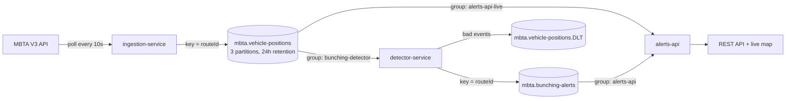

# MBTA Bus Bunching Detector

Real-time detection of bus bunching on live MBTA data, built with Apache Kafka and Spring Boot.

## The problem

You wait 20 minutes for the 39, and then two of them show up together. That is **bus bunching**: one bus falls a little behind, picks up the riders who would have caught the next bus, slows down even more at every stop, and the bus behind it catches up. Riders get long waits followed by back-to-back buses.

This project watches Boston bus routes in real time and flags the moment two buses on the same route and direction are running too close together. Over time, it also shows which routes bunch the most.

## Architecture



| Service | What it does |
|---|---|
| `ingestion-service` | Polls the MBTA `/vehicles` endpoint for the configured routes and publishes each updated bus position |
| `detector-service` | Tracks the latest position of every bus per route and direction, and publishes an alert when two buses are within 300 m |
| `alerts-api` | Serves recent alerts, a per-route bunching leaderboard, live bus positions, and a map page |
| `common` | Shared event records (`VehiclePosition`, `BunchingAlert`) and topic names |

## Kafka design decisions

**Positions are keyed by route ID.** Kafka guarantees order only within a partition, and the key decides the partition. Keying by route means every position for Route 39 lands on the same partition and reaches the same detector instance in order. That is what allows the detector to keep its state in memory: no shared database is needed, because no two instances ever see the same route.

**Two consumer groups read the same topic.** The detector and the alerts API both consume `mbta.vehicle-positions`, but in different groups, so each gets every message and tracks its own offsets. Adding another consumer later (for example, a service that archives positions for analysis) needs no change to the producer. This fan-out is one of the main reasons to use Kafka instead of a simple queue.

**The detector scales horizontally.** The positions topic has 3 partitions, so up to 3 detector instances can split the work. Try `docker compose up --scale detector-service=2` and watch the partitions rebalance in Kafka UI.

**Bad events go to a dead letter topic.** Unreadable JSON and impossible coordinates are sent straight to `mbta.vehicle-positions.DLT` with the error in the record headers. Unexpected failures are retried twice first. Either way, one bad message never blocks the consumer.

**At-least-once delivery.** Producers use `acks=all` and idempotence, so broker retries don't create duplicates. The detector waits for each alert to be acknowledged before the listener returns, so a position's offset is committed only after its alert is safely stored.

**Detection uses event time, which makes replay correct.** Staleness and alert cooldowns are measured with the MBTA timestamp on each position, not the server clock. Positions are retained for 24 hours, so setting `DETECTOR_REPLAY_FROM_BEGINNING=true` rewinds the detector and re-runs detection over the last day of data, for example to try a different distance threshold, and gets the same results it would have produced live.

## Detection rules

Two buses are flagged as bunched when all of these hold:

* same route and same direction of travel
* within 300 m of each other (straight-line distance)
* both reported a position within the last 2 minutes
* neither is waiting at the first stop of its trip (buses lay over together at terminals, which is normal)
* the same pair has not been flagged in the last 10 minutes

All thresholds are in `detector-service/src/main/resources/application.yml`.

## Running it

Requirements: Docker with Docker Compose.

```bash
cp .env.example .env    # optionally add a free MBTA API key
docker compose up --build
```

Then open:

* **http://localhost:8080** for the live map, the bunching leaderboard and recent alerts
* **http://localhost:8090** for Kafka UI (topics, partitions, consumer groups, messages)

An MBTA API key is optional. Without one, the API allows about 20 requests per minute, and the default 10 second polling uses 6. You can get a free key at [api-v3.mbta.com](https://api-v3.mbta.com).

Bunching depends on real traffic, so alerts are most frequent during rush hours.

### API

| Endpoint | Description |
|---|---|
| `GET /api/alerts?route=39&limit=50` | Recent alerts, newest first |
| `GET /api/alerts/summary` | Alert count per route, worst first |
| `GET /api/vehicles?route=39` | Latest position of each active bus |

## Tests

```bash
mvn verify
```

* `BunchingDetectorTest`: unit tests for every detection rule (distance, direction, layovers, cooldown, stale buses, invalid data)
* `MbtaVehicleParserTest`: parsing a real-shaped MBTA JSON:API response, including vehicles with missing data
* `BunchingFlowIntegrationTest`: starts a real Kafka broker with Testcontainers, sends positions through the detector, and checks that the alert and the dead letters come out the other side

The integration test needs Docker running. GitHub Actions runs the full suite on every push.

## Tech stack

Java 21, Spring Boot 3.5, Spring for Apache Kafka, Apache Kafka 3.9 (KRaft mode, no ZooKeeper), Testcontainers, Docker Compose, Leaflet.

## Limitations and next steps

* Distance is straight-line, not along the route. Using route shapes from the MBTA API would be more accurate on winding routes.
* State in the detector and the alerts API is in memory and rebuilt from Kafka on restart. Kafka Streams with a state store, or Postgres for alert history, would be the next step.
* Events are JSON. Avro with Schema Registry would enforce the event contract between services.
* A natural extension is gap detection: the opposite problem, where buses are spread too far apart and riders wait much longer than the schedule promises.

## Data

Uses real-time data from the [MBTA V3 API](https://www.mbta.com/developers/v3-api), subject to the MassDOT Developers License Agreement.
